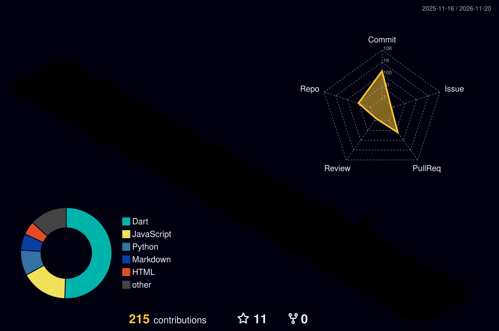

<div align="center">

<!-- Hero Card matching Portfolio Identity -->


<br/><br/>

<!-- Cohesive Social Badges -->
<a href="https://safiraodoohackathon.vercel.app/" target="_blank"></a>
<a href="https://www.linkedin.com/in/vanshshah37/" target="_blank"></a>
<a href="https://leetcode.com/u/VanshShah37/" target="_blank"></a>
<br/>
<a href="https://codeforces.com/profile/Vaether37" target="_blank"></a>
<a href="https://vanshshah37.github.io" target="_blank"></a>
<a href="mailto:contact@vanshshah.dev"></a>

<br/><br/>

<!-- Visitor Counter -->


</div>

<br/>

---

## ⚡ About Me

```
$ whoami
Vansh Shah — CS Undergrad, Problem Solver & Hackathon Finalist

$ cat focus.json
{
  "academics": "B.Tech Computer Science & Engineering @ Nirma University (CGPA 8.7+)",
  "algorithmic_speed": "315+ LeetCode Solved · Codeforces Rating 1095+ (Vaether37)",
  "open_source": "Active Contributor to microsoft/vscode-docs",
  "flagship_build": "Safira Luxury Travel OS (React 19, Tailwind CSS, Vite)",
  "philosophy": "Write clean code, optimize runtime complexity, and ship production-ready software."
}
```

Building high-performance software end-to-end — from algorithmic optimization in **C++** and offline-first personal data systems in **Flutter** to modern full-stack web platforms in **React 19 & Next.js**.

<br/>

---

## ⚔️ Live Problem Solving & Ratings

<table width="100%">
  <tr>
    <td width="50%" valign="top" align="center">
      <h3>LeetCode Performance</h3>
      <sub><b>@VanshShah37 · 315+ Solved · 52-Week Activity Heatmap</b></sub>
      <br/><br/>
      <a href="https://leetcode.com/u/VanshShah37/" target="_blank">
        
      </a>
    </td>
    <td width="50%" valign="top" align="center">
      <h3>Codeforces Arena</h3>
      <sub><b>@Vaether37 · Contest Rating 1095+</b></sub>
      <br/><br/>
      <a href="https://codeforces.com/profile/Vaether37" target="_blank">
        
      </a>
    </td>
  </tr>
</table>

<br/>

---

## 🧊 3D Isometric Contribution Architecture

<div align="center">

<picture>
  <source media="(prefers-color-scheme: dark)" srcset="./profile-3d-contrib/profile-night-rainbow.svg" />
  <source media="(prefers-color-scheme: light)" srcset="./profile-3d-contrib/profile-green.svg" />
  
</picture>

</div>

<br/>

---

## 🚀 Featured Production Systems

<table width="100%">
  <tr>
    <td width="33%" valign="top" align="center">
      <h3>Safira — Luxury Travel OS</h3>
      <sub><i>⚡ Odoo Hackathon Finalist</i></sub>
      <br/><br/>
      <p align="left">
        Ultra-premium travel operating system unifying multi-day bespoke itineraries, live budget vault, interactive calendar matrix, and excursion curation in a frosted-glass UI.
      </p>
      <br/>
      
      <br/><br/>
      <a href="https://safiraodoohackathon.vercel.app/" target="_blank"></a>
      <a href="https://github.com/vanshshah37/safira_odoo_hackathon" target="_blank"></a>
    </td>
    <td width="33%" valign="top" align="center">
      <h3>Family Vault</h3>
      <sub><i>🔐 Offline-First Privacy System</i></sub>
      <br/><br/>
      <p align="left">
        Private, cross-platform sanctuary for sensitive family records, credentials, and identities. Engineered with on-device SQLite storage and local encryption so data never leaves the device.
      </p>
      <br/>
      
      <br/><br/>
      <a href="https://github.com/vanshshah37/Family-vault" target="_blank"></a>
    </td>
    <td width="33%" valign="top" align="center">
      <h3>Database Analyzer &amp; CRM</h3>
      <sub><i>🗄️ Full-Stack Data Engine</i></sub>
      <br/><br/>
      <p align="left">
        Operational workspace transforming customer databases into high-confidence decisions with automated schema health checks, lead scoring, and low-latency Prisma query layer.
      </p>
      <br/>
      
      <br/><br/>
      <a href="https://github.com/vanshshah37/data_base_analysis" target="_blank"></a>
    </td>
  </tr>
</table>

<table width="100%">
  <tr>
    <td width="50%" valign="top">
      <h4>🗄️ DBSchemaX</h4>
      <p>Relational Schema and Functional Dependency Analyzer for database normalization, minimal cover, and candidate key synthesis.</p>
       &nbsp;
      <a href="https://github.com/vanshshah37/DBSchemaX"><b>View DBSchemaX Repo →</b></a>
    </td>
    <td width="50%" valign="top">
      <h4>🛰️ MemoryLane-Satellite</h4>
      <p>Geospatial memory and intelligence tooling designed for structured location mapping and historical tracking.</p>
       &nbsp;
      <a href="https://github.com/vanshshah37/MemoryLane-Satellite"><b>View MemoryLane Repo →</b></a>
    </td>
  </tr>
</table>

<br/>

---

## 🌐 Open Source Impact (Microsoft VS Code Docs)

<div align="center">
  <p>Active contributor to <b><a href="https://github.com/microsoft/vscode-docs">microsoft/vscode-docs</a></b>, improving developer documentation, CI validation pipelines, and workbench integrations.</p>
</div>

<table width="100%">
  <tr>
    <td width="50%" valign="top">
      <b>microsoft/vscode-docs</b> <a href="https://github.com/microsoft/vscode-docs/pull/10671"><code>PR #10671</code></a>
      <br/>
      <sub>fix(workbench): accept application/json with charset parameters</sub>
      <br/>
      <a href="https://github.com/microsoft/vscode-docs/pull/10671"><b>Inspect Pull Request ↗</b></a>
    </td>
    <td width="50%" valign="top">
      <b>microsoft/vscode-docs</b> <a href="https://github.com/microsoft/vscode-docs/pull/10670"><code>PR #10670</code></a>
      <br/>
      <sub>build: remove obsolete container mount paths from gitattributes</sub>
      <br/>
      <a href="https://github.com/microsoft/vscode-docs/pull/10670"><b>Inspect Pull Request ↗</b></a>
    </td>
  </tr>
  <tr>
    <td width="50%" valign="top">
      <b>microsoft/vscode-docs</b> <a href="https://github.com/microsoft/vscode-docs/pull/10669"><code>PR #10669</code></a>
      <br/>
      <sub>build: add feature lifecycle validation script, unit tests, and CI check</sub>
      <br/>
      <a href="https://github.com/microsoft/vscode-docs/pull/10669"><b>Inspect Pull Request ↗</b></a>
    </td>
    <td width="50%" valign="top">
      <b>microsoft/vscode-docs</b> <a href="https://github.com/microsoft/vscode-docs/pull/10668"><code>PR #10668</code></a>
      <br/>
      <sub>docs: fix broken cross-reference anchors across documentation</sub>
      <br/>
      <a href="https://github.com/microsoft/vscode-docs/pull/10668"><b>Inspect Pull Request ↗</b></a>
    </td>
  </tr>
</table>

<br/>

---

## 🛠️ Technical Arsenal

<div align="center">

**Languages &amp; Core Engines**
<br/>
<a href="https://skillicons.dev"></a>

<br/><br/>

**Frontend, Mobile &amp; Frameworks**
<br/>
<a href="https://skillicons.dev"></a>

<br/><br/>

**Backend, Data &amp; DevOps**
<br/>
<a href="https://skillicons.dev"></a>

</div>

<br/>

---

## 📈 Activity & Real-Time Analytics

<div align="center">

<!-- GitHub Activity Graph -->


<br/><br/>

<!-- Real-time Stats & Streak -->


</div>

<br/>

---

<div align="center">
  <sub>Engineered with precision by <b><a href="https://vanshshah37.github.io">Vansh Shah</a></b> · Built for high performance &amp; algorithmic excellence.</sub>
</div>
